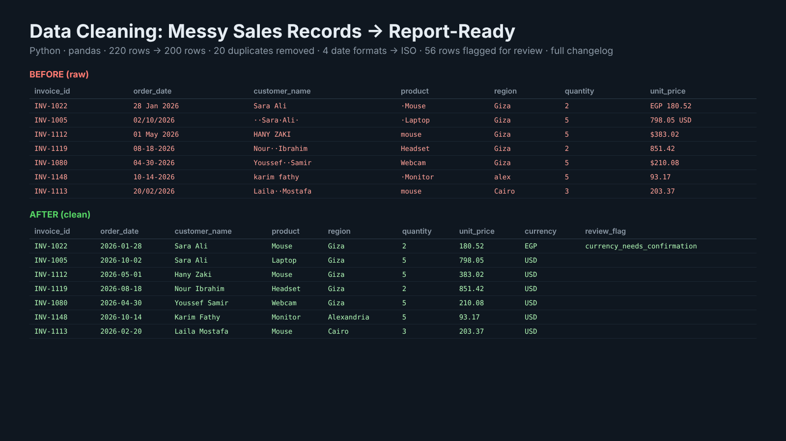
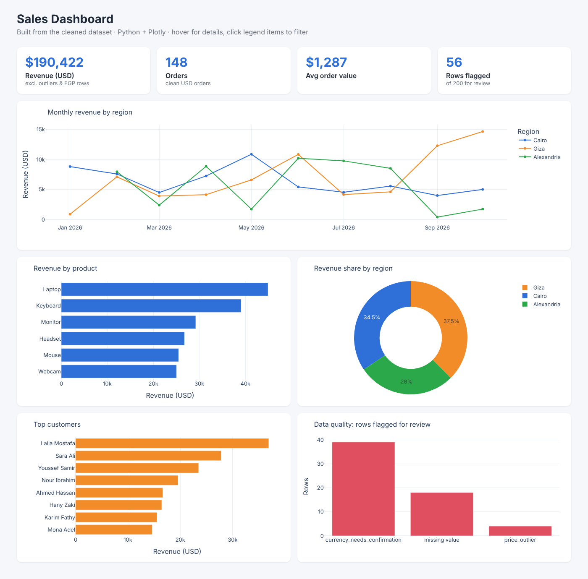

# Data Cleaning & Dashboard Demo: Messy Sales Records → Report-Ready Insights

A Python (pandas) pipeline that turns an inconsistent sales export into a clean, validated dataset with a full changelog. Every change is logged, and nothing valid is silently overwritten: questionable values are **flagged for review**, not deleted.



> The dataset is synthetic (generated by `make_messy_data.py`) so the project can be shared publicly.

## Problems in the raw data (`data/raw_sales.csv`, 220 rows)

| Issue | Example |
|---|---|
| Mixed date formats | `28 Jan 2026`, `02/10/2026`, `08-18-2026`, `2026-03-01` |
| Inconsistent names / extra whitespace | `HANY ZAKI`, `  Sara Ali `, `Nour  Ibrahim` |
| Mixed currency formatting | `$383.02`, `798.05 USD`, `1,204.50`, `EGP 180.52` |
| Region aliases | `alex`, `ALEXANDRIA`, `Alexandria` |
| Corrupted quantities | `abc`, `-3`, `?` |
| Outliers | unit price `999999` |
| Missing values | empty customer, region, or quantity |
| Duplicates | exact copies and copies that differ only in case/spacing |

## What the pipeline does (`clean_data.py`)

1. Trims whitespace and normalizes case in text columns
2. Maps region aliases to one canonical name
3. Parses all date formats into ISO `YYYY-MM-DD`
4. Strips currency symbols and separators, **keeping the detected currency in its own column**; EGP rows are flagged instead of being treated as USD
5. Sets invalid quantities to empty and flags them
6. Removes duplicates (after normalization, so near-duplicates are caught)
7. Flags rows with missing required fields, price outliers, or currency needing confirmation
8. Runs integrity checks (unique `invoice_id`, valid ISO dates) before writing output

## Result

| | Before | After |
|---|---|---|
| Rows | 220 | 200 (20 duplicates removed) |
| Date formats | 4 | 1 (ISO) |
| Duplicate invoices | 20 | 0 |
| Rows needing human review | hidden | 56, clearly flagged in `review_flag` |

## Dashboard (`dashboard.py`)

An interactive dashboard (Python + Plotly) built on the cleaned data: KPI row, monthly revenue by region, revenue by product, regional share, top customers, and a data-quality panel showing what was flagged. Open `output/dashboard.html` in a browser for hover details and legend filtering.



Revenue figures exclude price outliers and EGP rows (no exchange rate is assumed), and the dashboard shows how many rows were excluded, so nothing is hidden.

## Output (`output/`)

- `clean_sales.csv`: cleaned data with `currency`, `review_flag` and `line_total` columns
- `clean_sales.xlsx`: same data, plus a `changelog` sheet
- `changelog.csv`: every step with the number of rows affected
- `dashboard.html`: the interactive dashboard

## Run it

```bash
pip install pandas openpyxl
python make_messy_data.py          # creates data/raw_sales.csv
python clean_data.py data/raw_sales.csv output/
pip install plotly
python dashboard.py output/clean_sales.csv output/dashboard.html
```

## Author

Saif Aboalnaga — Cybersecurity & Cloud Engineer
